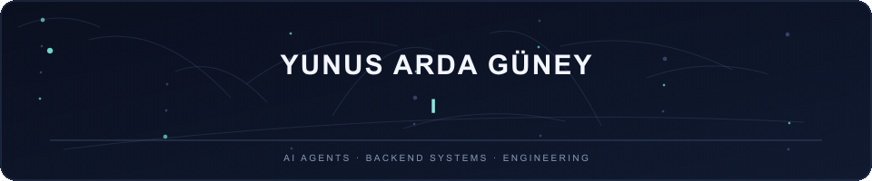

# Yunus Arda Güney
### AI Systems & Autonomous Agents Engineer · Founder @ Solveny & Randevuo

  
  
  
  

  <em>Building <strong>production AI agents</strong>, <strong>verifiable execution runtimes</strong>, and <strong>infrastructure for the Model Context Protocol (MCP)</strong>.</em> 
  <em>Electrical & Electronics Engineering · İzmir Kâtip Çelebi University</em>

---

## ⚡ Flagship Open-Source Projects

<table>
  <tr>
    <td width="50%" valign="top">
      <h3>📊 <a href="https://github.com/yunusarda-sudo/mcp-benchmark">MCP Benchmark</a></h3>
      
<strong>The Google Lighthouse & Linter for Model Context Protocol (MCP).</strong>

      <ul>
        <li>Deterministic Tool Quality Index (TQI) scoring (0–100)</li>
        <li>Living reference corpus of <strong>130+ standard & community MCP servers</strong></li>
        <li>Token footprint cost optimizer, breaking change gate & 1-click auto-fixer</li>
        <li><a href="https://yunusarda-sudo.github.io/mcp-benchmark/">Interactive Web Playground & Leaderboard</a></li>
      </ul>
      

        
        
        
      

    </td>
    <td width="50%" valign="top">
      <h3>🎙️ <a href="https://github.com/yunusarda-sudo/arda-suite">AegisOS</a></h3>
      
<strong>Local-first desktop voice assistant & verifiable bounded agent runtime.</strong>

      <ul>
        <li><strong>Jarvis:</strong> macOS menu bar voice assistant with instant push-to-talk (<code>⌘⇧A</code>) and dictation (<code>⌘⇧D</code>)</li>
        <li><strong>Verifiable Engine:</strong> Deterministic <code>AUTO / CONFIRM / DENY</code> tool permission gates</li>
        <li><strong>Shared Memory:</strong> Standalone long-term vector memory daemon (Mem0 + Qdrant) over MCP</li>
      </ul>
      

        
        
        
      

    </td>
  </tr>
  <tr>
    <td width="50%" valign="top">
      <h3>🔄 <a href="https://github.com/yunusarda-sudo/handoffstone">handoffstone</a></h3>
      
<strong>Portable, verifiable context handoffs between autonomous AI agents.</strong>

      <ul>
        <li>Versioned decision schema capturing what was decided, why, and active constraints</li>
        <li>MCP bridge enabling seamless context sharing across disparate agent clients</li>
        <li>Tamper-evident audit trails and structured capsule handoffs</li>
      </ul>
      

        
        
        
      

    </td>
    <td width="50%" valign="top">
      <h3>🤖 <a href="https://github.com/yunusarda-sudo/desktopagent">Desktop Agent</a></h3>
      
<strong>Autonomous computer-use agent & desktop task execution harness.</strong>

      <ul>
        <li>Vision-based screen perception, OCR, and native desktop input synthesis</li>
        <li>Self-correcting tool loops for complex multi-app desktop workflows</li>
        <li>Local LLM and cloud multimodal model orchestration</li>
      </ul>
      

        
        
      

    </td>
  </tr>
</table>

---

## 🌐 Open-Source Contributions & Ecosystem Impact

  <strong>77+ merged pull requests</strong> across 21 upstream AI agent, MCP infrastructure, and developer tooling repositories:

- 🟣 **[modelcontextprotocol/inspector](https://github.com/modelcontextprotocol/inspector)** *(Official Anthropic MCP)* — Isolated CLI test suites from developer OAuth state using sandboxed temp environments ([#2719](https://github.com/modelcontextprotocol/inspector/issues/2719)).
- 🤖 **[All-Hands-AI/OpenHands](https://github.com/All-Hands-AI/OpenHands)** — Prioritized draft validation errors over stale historical test runs in Agent Canvas ([#18609](https://github.com/All-Hands-AI/OpenHands/pull/18609)).
- ⚡ **[PrefectHQ/fastmcp](https://github.com/PrefectHQ/fastmcp)** — Propagated public metadata across built-in file, directory, and HTTP MCP resources ([#5795](https://github.com/PrefectHQ/fastmcp/pull/5795)).
- 🌐 **[browser-use/browser-use](https://github.com/browser-use/browser-use)** — Filtered non-positive and out-of-bounds coordinates in DOM paint order for vision web agents ([#6126](https://github.com/browser-use/browser-use/pull/6126)).
- 📦 **[coderamp-labs/gitingest](https://github.com/coderamp-labs/gitingest)** — Enforced max file size limits & preserved notebook cell outputs ([#610](https://github.com/coderamp-labs/gitingest/pull/610), [#611](https://github.com/coderamp-labs/gitingest/pull/611)).
- 🦀 **[Muvon/octomind](https://github.com/Muvon/octomind)** — Implemented `serde_ignored` diagnostics and TOML scalar-after-table trap detection in Rust ([#177](https://github.com/Muvon/octomind/pull/177)).
- ⚙️ **[OpenAdaptAI/OpenAdapt](https://github.com/OpenAdaptAI/OpenAdapt)** — 23 merged PRs across desktop automation concurrency, process telemetry, and runtime diagnostics.
- 🛠️ **[uutils (GNU in Rust)](https://github.com/uutils)** — 12 merged PRs across `sed`, `grep`, `findutils`, and `diffutils` compatibility fixes.

  <a href="https://github.com/search?q=author%3Ayunusarda-sudo+is%3Apr+is%3Amerged+-user%3Ayunusarda-sudo&type=pullrequests"><strong>👉 View all 77+ merged pull requests on GitHub →</strong></a>

---

## 💼 Ventures & Production Systems

<table>
  <tr>
    <td width="33%" valign="top">
      <h4>📅 <a href="https://randevuo.com.tr/">Randevuo</a></h4>
      
WhatsApp-first autonomous AI appointment booking agents for service businesses. Zero app install, natural multi-turn conversational scheduling.

    </td>
    <td width="33%" valign="top">
      <h4>🏢 <a href="https://solveny.tech/">Solveny</a></h4>
      
Custom AI agent implementations, enterprise workflow automation, and multi-agent systems. (<a href="https://solveny.dev">solveny.dev</a>)

    </td>
    <td width="33%" valign="top">
      <h4>⚡ <a href="https://modu-grid.com/">MODÜ-GRID</a></h4>
      
IoT & AI-driven energy consumption telemetry and load optimization for commercial and industrial facilities.

    </td>
  </tr>
</table>

---

## 🛠️ Tech Stack & Engineering Systems

  
  
  
  
  
  
  
  
  
  
  
  

 

  
  

