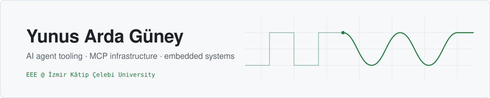

<picture>
  <source media="(prefers-color-scheme: dark)" srcset="./assets/header-dark.svg" />
  <source media="(prefers-color-scheme: light)" srcset="./assets/header-light.svg" />
  
</picture>

Electrical & Electronics Engineering student at İzmir Kâtip Çelebi University. I build **tooling for AI agents** — MCP servers, benchmarks, permission-gated runtimes, shared memory — and the **embedded / edge** hardware they end up running next to.

  
  
  
  
  
  
  
  
  
  

## Open-source projects

### [mcp-benchmark](https://github.com/yunusarda-sudo/mcp-benchmark)
Deterministic quality benchmark and linter for MCP tool definitions. Scores schema strictness, description quality and context-token cost, ships a reference corpus of 130 public MCP servers, and runs as a CLI or GitHub Action with SARIF output. · TypeScript · MIT

### [handoffstone](https://github.com/yunusarda-sudo/handoffstone)
Portable, verifiable context handoffs between AI agents: a versioned schema for what was decided and why, plus an MCP bridge so different clients can pick up the same work. · Python · Apache-2.0

### [ARDA Suite](https://github.com/yunusarda-sudo/arda-suite)
Local-first assistant stack: a macOS menu-bar voice assistant (also runs headless on Linux / Raspberry Pi), an agent runtime with `AUTO / CONFIRM / DENY` tool gates and audit logs, and a shared memory service on mem0 + Qdrant exposed over MCP. · Python

## Contributions

77 merged pull requests across 21 upstream projects. The larger ones:

| Project | Merged | Area |
| :--- | ---: | :--- |
| [OpenAdaptAI/OpenAdapt](https://github.com/OpenAdaptAI/OpenAdapt/pulls?q=is%3Apr+author%3Ayunusarda-sudo+is%3Amerged) | 23 | Desktop automation agent — concurrency fixes, diagnostics, docs |
| [XAGI-Lab/melra](https://github.com/XAGI-Lab/melra/pulls?q=is%3Apr+author%3Ayunusarda-sudo+is%3Amerged) | 12 | Local MCP execution runtime — browser tab races, policy checks |
| [uutils](https://github.com/uutils) `sed` · `grep` · `findutils` · `diffutils` | 12 | Rust rewrites of GNU tools — GNU compatibility fixes |
| [Muvon/octomind](https://github.com/Muvon/octomind/pulls?q=is%3Apr+author%3Ayunusarda-sudo+is%3Amerged) | 8 | Rust coding-agent runtime — config validation |
| [pyrite-wiki/pyrite](https://github.com/pyrite-wiki/pyrite/pulls?q=is%3Apr+author%3Ayunusarda-sudo+is%3Amerged) | 6 | Knowledge-as-code CLI — input bounds, schema validation |
| [Agenta-AI/agenta](https://github.com/Agenta-AI/agenta/pulls?q=is%3Apr+author%3Ayunusarda-sudo+is%3Amerged) | 4 | LLMOps platform — API fixes |

Also merged in rustdesk, OpenHands, neo.mjs, taskade/mcp, CORAL, CrewForm, flisk and others — [full list](https://github.com/search?q=author%3Ayunusarda-sudo+is%3Apr+is%3Amerged+-user%3Ayunusarda-sudo&type=pullrequests).

## Products

- [**Randevuo**](https://randevuo.com.tr/) — WhatsApp-based AI appointment booking for service businesses.
- [**Solveny**](https://solveny.tech/) — custom AI agent implementations and workflow automation.
- [**MODÜ-GRID**](https://modu-grid.com/) — IoT and AI-driven energy optimization for commercial facilities.

## Contact

[solveny.dev](https://solveny.dev) · İzmir, Türkiye
